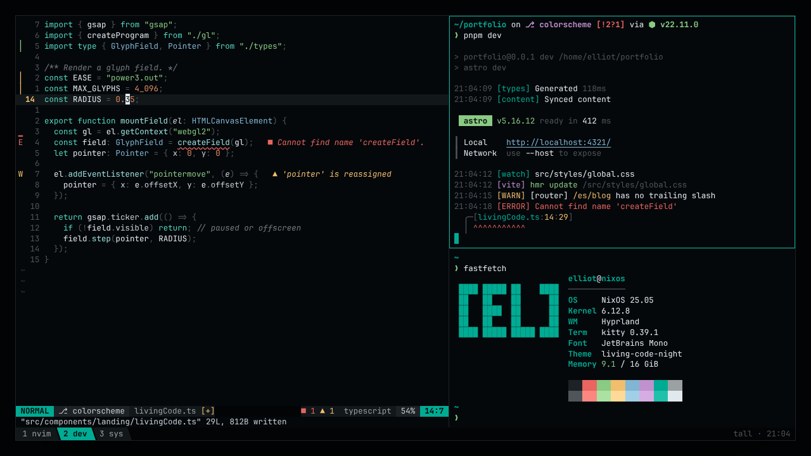
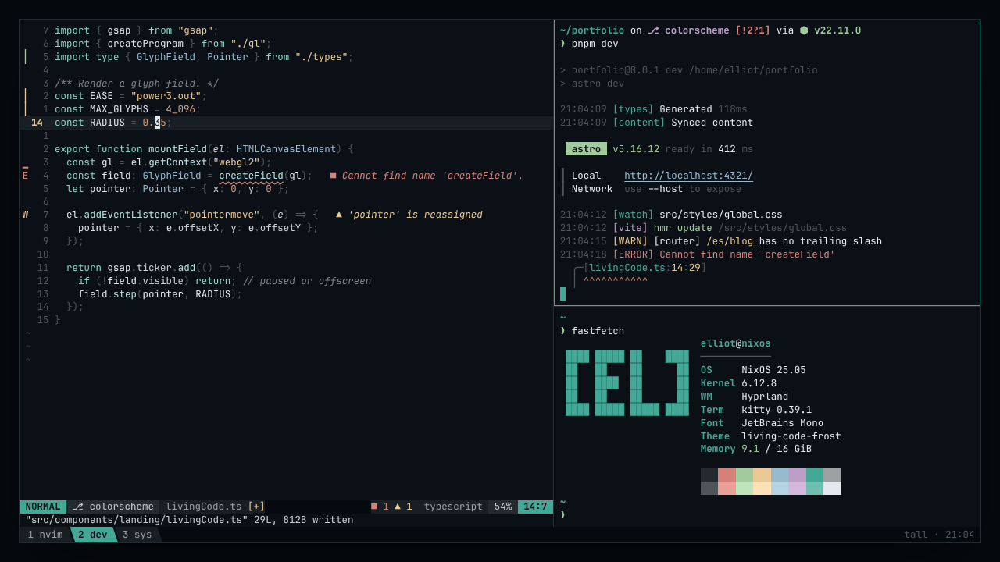
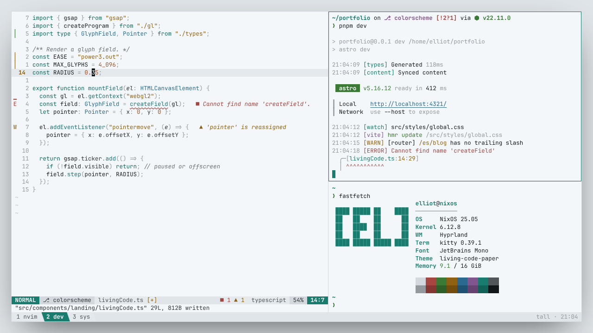
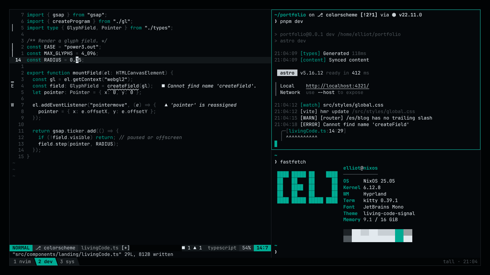
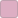
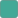
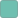
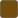

<h1 align="center">Living Code</h1>

<p align="center"><b>Calm slate. Living color.</b><br>
A color scheme where the background stays quiet and the code comes alive.<br>
For editors, terminals, browsers and the web.</p>

<p align="center">




</p>

This is the **core** of Living Code: the palette, the color math that resolves it, semantic roles, the `[lc]` brand and
shared tooling. It is agnostic to any app. Each port lives in its own repository in
[living-code-theme](https://github.com/living-code-theme), and [living-code.dev](https://living-code.dev) lists them all.

## Choose a flavor

Every flavor shares the same slate foundation and semantic roles. Night is the default.

| Flavor | Appearance | Syntax and accents |
|---|---|---|
| [Night](#living-code-night) | Dark slate, full palette | Cool structure, green strings, copper numbers and amber warnings. The default. |
| [Frost](#living-code-frost) | Lifted, bluer slate | Lower-chroma accents with green strings and copper numbers. |
| [Paper](#living-code-paper) | Near-white slate | Darker accents with green strings and copper numbers. |
| [Signal](#living-code-signal) | Dark slate, one accent | Minimal variant of Night: teal keywords and tags, everything else neutral. |

## Install

Install the port for your app: find it on [living-code.dev/ports](https://living-code.dev/ports/) or in the
[organization's repositories](https://github.com/orgs/living-code-theme/repositories). Each port's README has its
installation steps. Nobody needs to clone this repository to use the theme.

## Design

- **The ground stays calm.** Backgrounds, panels, selections, punctuation and comments live on one slate ramp, so the eye goes to the code, not the chrome.
- **Cool for structure, warm for data.**  Teal, aqua and steel mark keywords, functions and types;  moss,  amber and  copper mark strings, numbers and warnings.
- **Same roles everywhere.** Each port maps the same semantic roles (keyword, string, error, border...), so a theme feels the same in your editor, terminal and browser.
- **Built in OKLCH.** Every palette value is defined in OKLCH; hex and RGB are derived. The build checks 24 text roles for WCAG AA contrast (≥ 4.5:1) against each flavor's background.

## Flavors

### Living Code Night

The default. Dark slate ground, teal structure, green strings and gray comments. Amber warnings and copper numbers keep their warm contrast.


<details open>
<summary>Palette</summary>

**Neutrals**

| | Name | Hex | OKLCH | Used for |
|:-:|---|---|---|---|
|  | `crust` | `#020405` | `oklch(0.1 0.01 240)` | sidebars, tab bars, status lines |
|  | `base` | `#05080b` | `oklch(0.13 0.01 240)` | background |
|  | `mantle` | `#090e11` | `oklch(0.16 0.01 240)` | floats, cards, popups |
|  | `surface0` | `#12171a` | `oklch(0.2 0.01 240)` | line highlight, inactive tabs |
|  | `surface1` | `#1d2226` | `oklch(0.25 0.01 240)` | borders, ANSI black |
|  | `surface2` | `#2d3438` | `oklch(0.32 0.012 240)` | selection |
|  | `overlay` | `#50565b` | `oklch(0.45 0.012 240)` | line numbers, punctuation |
|  | `comment` | `#747c80` | `oklch(0.58 0.012 235)` | comments, operators |
|  | `subtext` | `#9ba0a2` | `oklch(0.7023 0.0065 223.49)` | muted text, ANSI white |
|  | `text2` | `#c8cfd4` | `oklch(0.85 0.01 240)` | properties, parameters |
|  | `text` | `#e2e9ee` | `oklch(0.93 0.01 240)` | foreground |

**Accents**

| | Name | Hex | OKLCH | Used for |
|:-:|---|---|---|---|
|  | `teal` | `#00a692` | `oklch(0.65 0.15 180)` | accent · cursor · borderActive · heading |
|  | `mint` | `#52d7c1` | `oklch(0.8 0.12 180)` | hint · keyword · builtin |
|  | `aqua` | `#9ae0dd` | `oklch(0.86 0.07 192)` | function · link |
|  | `steel` | `#80b6d3` | `oklch(0.75 0.07 232)` | info · type · namespace |
|  | `amber` | `#f0be6d` | `oklch(0.83 0.115 78)` | lineNumberActive · match · warning · modified · code |
|  | `copper` | `#e18c5f` | `oklch(0.72 0.12 48)` | number · constant · escape |
|  | `flare` | `#e96560` | `oklch(0.67 0.165 25)` | error · removed |
|  | `moss` | `#8acb83` | `oklch(0.78 0.12 142)` | success · added · string |
|  | `orchid` | `#bf91cd` | `oklch(0.72 0.1 318)` | regex · decorator · tag |
|  | `rose` | `#ddaec3` | `oklch(0.8 0.06 350)` | Available for custom accents |

**ANSI**

| | black | red | green | yellow | blue | magenta | cyan | white |
|---|:-:|:-:|:-:|:-:|:-:|:-:|:-:|:-:|
| normal |  |  |  |  |  |  |  |  |
| bright |  |  |  |  |  |  |  |  |

</details>

### Living Code Frost

Night on a lifted, bluer slate with a third less chroma. Calmer for long sessions; the warm/cool split survives at low saturation.


<details>
<summary>Palette</summary>

**Neutrals**

| | Name | Hex | OKLCH | Used for |
|:-:|---|---|---|---|
|  | `crust` | `#050a0f` | `oklch(0.14 0.015 245)` | sidebars, tab bars, status lines |
|  | `base` | `#0a1016` | `oklch(0.17 0.015 245)` | background |
|  | `mantle` | `#10171c` | `oklch(0.2 0.015 245)` | floats, cards, popups |
|  | `surface0` | `#171e24` | `oklch(0.23 0.015 245)` | line highlight, inactive tabs |
|  | `surface1` | `#232a30` | `oklch(0.28 0.015 245)` | borders, ANSI black |
|  | `surface2` | `#333c43` | `oklch(0.35 0.018 245)` | selection |
|  | `overlay` | `#50565b` | `oklch(0.45 0.012 240)` | line numbers, punctuation |
|  | `comment` | `#7d8489` | `oklch(0.61 0.012 235)` | comments, operators |
|  | `subtext` | `#9ba0a2` | `oklch(0.7023 0.0065 223.49)` | muted text, ANSI white |
|  | `text2` | `#c8cfd4` | `oklch(0.85 0.01 240)` | properties, parameters |
|  | `text` | `#e2e9ee` | `oklch(0.93 0.01 240)` | foreground |

**Accents**

| | Name | Hex | OKLCH | Used for |
|:-:|---|---|---|---|
|  | `teal` | `#43a997` | `oklch(0.67 0.0975 180)` | accent · cursor · borderActive · heading |
|  | `mint` | `#8ad5c6` | `oklch(0.82 0.078 180)` | hint · keyword · builtin |
|  | `aqua` | `#b6e2df` | `oklch(0.88 0.0455 192)` | function · link |
|  | `steel` | `#98bacd` | `oklch(0.77 0.0455 232)` | info · type · namespace |
|  | `amber` | `#e9c897` | `oklch(0.85 0.0748 78)` | lineNumberActive · match · warning · modified · code |
|  | `copper` | `#d49c80` | `oklch(0.74 0.078 48)` | number · constant · escape |
|  | `flare` | `#d68079` | `oklch(0.69 0.1073 25)` | error · removed |
|  | `moss` | `#a2cb9d` | `oklch(0.8 0.078 142)` | success · added · string |
|  | `orchid` | `#bc9ec6` | `oklch(0.74 0.065 318)` | regex · decorator · tag |
|  | `rose` | `#d9bac8` | `oklch(0.82 0.039 350)` | Available for custom accents |

**ANSI**

| | black | red | green | yellow | blue | magenta | cyan | white |
|---|:-:|:-:|:-:|:-:|:-:|:-:|:-:|:-:|
| normal |  |  |  |  |  |  |  |  |
| bright |  |  |  |  |  |  |  |  |

</details>

### Living Code Paper

Daylight. Same two temperatures on near-white slate, lightness inverted so every syntax color keeps WCAG AA contrast.


<details>
<summary>Palette</summary>

**Neutrals**

| | Name | Hex | OKLCH | Used for |
|:-:|---|---|---|---|
|  | `crust` | `#e0e5e9` | `oklch(0.92 0.008 240)` | sidebars, tab bars, status lines |
|  | `base` | `#f4f7f9` | `oklch(0.975 0.004 240)` | background |
|  | `mantle` | `#ebeff2` | `oklch(0.95 0.006 240)` | floats, cards, popups |
|  | `surface0` | `#e3e9ed` | `oklch(0.93 0.008 240)` | line highlight, inactive tabs |
|  | `surface1` | `#d2d8dd` | `oklch(0.88 0.01 240)` | borders, ANSI black |
|  | `surface2` | `#c2ccd3` | `oklch(0.84 0.015 240)` | selection |
|  | `overlay` | `#92999f` | `oklch(0.68 0.012 240)` | line numbers, punctuation |
|  | `comment` | `#6b7378` | `oklch(0.55 0.012 235)` | comments, operators |
|  | `subtext` | `#50565a` | `oklch(0.45 0.01 240)` | muted text, ANSI white |
|  | `text2` | `#2e3437` | `oklch(0.32 0.01 240)` | properties, parameters |
|  | `text` | `#12171a` | `oklch(0.2 0.01 240)` | foreground |

**Accents**

| | Name | Hex | OKLCH | Used for |
|:-:|---|---|---|---|
|  | `teal` | `#187d6e` | `oklch(0.53 0.09 180)` | accent · cursor · borderActive · heading |
|  | `mint` | `#0f695e` | `oklch(0.47 0.08 182)` | hint · keyword · builtin |
|  | `aqua` | `#1f7074` | `oklch(0.5 0.075 200)` | function · link |
|  | `steel` | `#2b6991` | `oklch(0.5 0.09 240)` | info · type · namespace |
|  | `amber` | `#8f6213` | `oklch(0.53 0.105 75)` | lineNumberActive · match · warning · modified · code |
|  | `copper` | `#a04f27` | `oklch(0.52 0.12 45)` | number · constant · escape |
|  | `flare` | `#a74541` | `oklch(0.52 0.13 25)` | error · removed |
|  | `moss` | `#3b7a35` | `oklch(0.52 0.12 142)` | success · added · string |
|  | `orchid` | `#81558e` | `oklch(0.52 0.1 318)` | regex · decorator · tag |
|  | `rose` | `#845b6e` | `oklch(0.52 0.06 350)` | Available for custom accents |

**ANSI**

| | black | red | green | yellow | blue | magenta | cyan | white |
|---|:-:|:-:|:-:|:-:|:-:|:-:|:-:|:-:|
| normal |  |  |  |  |  |  |  |  |
| bright |  |  |  |  |  |  |  |  |

</details>

### Living Code Signal

A minimal variant of Night with a single accent. Teal marks keywords, tags and focus; everything else stays on the slate ramp. No warm literals or multicolor diagnostics.


Accent names such as `amber`, `copper` and `moss` remain available for port compatibility,
but in Signal they are aliases of teal or neutral colors. Diagnostics are told apart by labels, signs and underlines instead of hue.

<details>
<summary>Palette</summary>

**Neutrals**

| | Name | Hex | OKLCH | Used for |
|:-:|---|---|---|---|
|  | `crust` | `#020405` | `oklch(0.1 0.01 240)` | sidebars, tab bars, status lines |
|  | `base` | `#05080b` | `oklch(0.13 0.01 240)` | background |
|  | `mantle` | `#090e11` | `oklch(0.16 0.01 240)` | floats, cards, popups |
|  | `surface0` | `#12171a` | `oklch(0.2 0.01 240)` | line highlight, inactive tabs |
|  | `surface1` | `#1d2226` | `oklch(0.25 0.01 240)` | borders, ANSI black |
|  | `surface2` | `#2d3438` | `oklch(0.32 0.012 240)` | selection |
|  | `overlay` | `#50565b` | `oklch(0.45 0.012 240)` | line numbers, punctuation |
|  | `comment` | `#747c80` | `oklch(0.58 0.012 235)` | comments, operators |
|  | `subtext` | `#9ba0a2` | `oklch(0.7023 0.0065 223.49)` | muted text, ANSI white |
|  | `text2` | `#c8cfd4` | `oklch(0.85 0.01 240)` | properties, parameters |
|  | `text` | `#e2e9ee` | `oklch(0.93 0.01 240)` | foreground |

**Accent**

| | Name | Hex | OKLCH | Used for |
|:-:|---|---|---|---|
|  | `teal` | `#00a692` | `oklch(0.65 0.15 180)` | accent · cursor · borderActive · match · modified · keyword · builtin · decorator · tag · heading · link |

**ANSI**

| | black | red | green | yellow | blue | magenta | cyan | white |
|---|:-:|:-:|:-:|:-:|:-:|:-:|:-:|:-:|
| normal |  |  |  |  |  |  |  |  |
| bright |  |  |  |  |  |  |  |  |

</details>

### Syntax roles

| Role | Night | Frost | Paper | Signal |
|---|---|---|---|---|
| keyword |  `mint` |  `mint` |  `mint` |  `teal` |
| function |  `aqua` |  `aqua` |  `aqua` |  `text` |
| type |  `steel` |  `steel` |  `steel` |  `text2` |
| string |  `moss` |  `moss` |  `moss` |  `text` |
| number |  `copper` |  `copper` |  `copper` |  `text` |
| decorator |  `orchid` |  `orchid` |  `orchid` |  `teal` |
| property |  `text2` |  `text2` |  `text2` |  `text2` |
| operator |  `comment` |  `comment` |  `comment` |  `comment` |
| comment |  `comment` |  `comment` |  `comment` |  `comment` |

The table shows resolved roles for every flavor. The full role map (UI, diagnostics, markup) is in
[`palette/flavors.mjs`](palette/flavors.mjs): `defaultRoles` plus each flavor's `roles` overrides.

Ports ship every flavor, except browser themes (Firefox and Chrome), which ship Night and Paper only: in a browser's few
theme slots, Frost and Signal look the same as or barely different from Night, and both stores reject duplicate themes.

## Using the palette in something else

Any app can follow the theme: read [`palette.json`](palette.json) (hex, OKLCH, RGB, roles and ANSI for every flavor),
or map these semantic roles onto the app's own color slots:

| Slot | Role | Night |
|---|---|---|
| background / foreground | `bg` / `fg` | `#05080b` / `#e2e9ee` |
| panels, sidebars | `bgDeep`, `bgAlt` | `#020405`, `#090e11` |
| accent, cursor, focus ring | `accent` | `#00a692` |
| selection | `selection` | `#2d3438` |
| borders | `border` / `borderActive` | `#1d2226` / `#00a692` |
| error / warning / info / success | `error` … | `#e96560` `#f0be6d` `#80b6d3` `#8acb83` |

From JavaScript, install [`@living-code/palette`](https://github.com/living-code-theme/palette); for CSS custom
properties, [`@living-code/css`](https://github.com/living-code-theme/css).

## Recolor images

Turn any image, such as a wallpaper, into a Living Code version. Requires [ImageMagick 7](https://imagemagick.org).

```sh
node scripts/recolor.mjs wallpaper.jpg --flavor night --mode lut
```

| Mode | Result |
|---|---|
| `lut` | Starts with the theme's slate ramp. Shadows and muted areas stay neutral; colorful midtones receive the selected flavor's accents over that base. Lightness is fitted to the theme's range. Tune the accent amount with `--color` (default: 0.65). Core accents are teal, mint, aqua, steel, amber and copper; `--accents all` includes the remaining accents. |
| `gradient` | Maps brightness onto dark slate, an accent and light text. Pick the accent with `--accent amber`. |
| `remap` | Posterizes to the exact palette colors. Add `--no-dither` for flat areas. |
| `all` | Writes one file per mode. |

In `lut` mode, `--color 0` uses only the slate ramp; `--color 1` allows stronger accents while still protecting shadows and muted areas.
Unlike `--strength`, lowering `--color` does not bring back the original photo's colors. It controls accent blending, not a fixed percentage of the image's area.
Other controls are `--spread` (hue blending), `--keep-light` (brightness preservation) and `--smooth` (color-noise smoothing).
Use `--flavor signal` for slate and teal only; compatibility names such as `amber` do not add warm hues in Signal.

Output defaults to `<image>-<flavor>-<mode>.png` next to the input. Run with `--help` for every option.

## Report a problem or request a port

| You want to | Where |
|---|---|
| Report wrong colors or a broken install in one app | That app's repository: open its page on [living-code.dev/ports](https://living-code.dev/ports/), then **Report an issue** |
| Ask for Living Code in another app | [Request a port](https://github.com/living-code-theme/core/issues/new?template=port-request.yml) |
| Change a color or role in every app | [Palette or color feedback](https://github.com/living-code-theme/core/issues/new?template=color-feedback.yml) |

## Contributing a port

Each port is its own repository in [living-code-theme](https://github.com/living-code-theme) with a root `port.json`
and a README following the shared template; the website discovers it automatically. See [Port repositories](docs/PORTS.md).

Map roles, never colors: take every color from a semantic role in [`palette.json`](palette.json), so the same kind of
token gets the same color in every app.

## Development

Requires Node 22.22 or newer. There are no runtime dependencies.

| Command | What it does |
|---|---|
| `pnpm build` | Regenerates `palette.json`, this README, swatches, brand SVGs and the landing export from `palette/flavors.mjs`. |
| `pnpm check` | Fails if a generated file is stale or a text role drops below 4.5:1. CI runs it. |
| `pnpm test` | Runs the test suite. |
| `pnpm preview` | Live palette preview with sliders and exports at <http://localhost:4173/preview/>. |
| `pnpm screenshots` | Recaptures `assets/preview-*.png` from the preview with headless Chrome (`CHROME_BIN` overrides `google-chrome`). |
| `pnpm icons:brand` | Rasterizes the brand SVGs to PNG and ICO. See [`assets/brand`](assets/brand/README.md). |

To change a color, edit [`palette/flavors.mjs`](palette/flavors.mjs) and run `pnpm build`. Do not edit generated files directly.

A palette change does not touch any port: each port repository owns its files and updates them in its own pull request.
The website takes the theme from [`exports/landing/`](exports/landing): copy `theme.json` to the landing's
`data/theme.json` and `theme.css` to `src/styles/theme.css`.

## License

[MIT](LICENSE) © Elliot Luque
